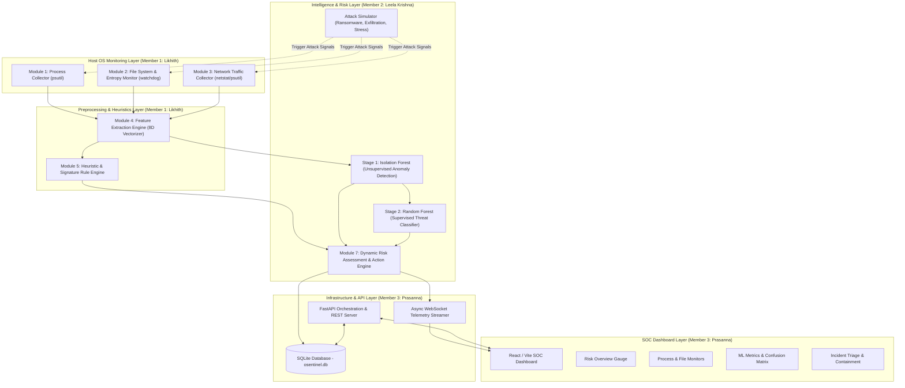
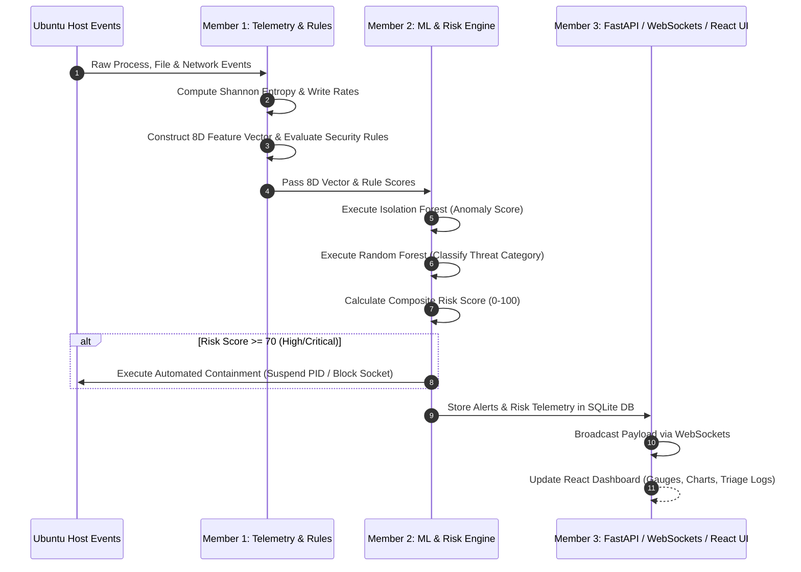
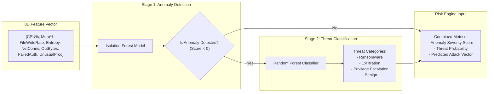
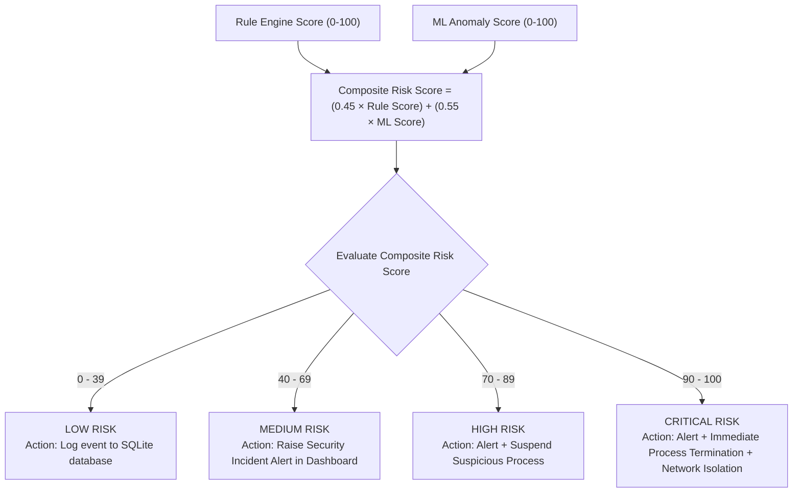

# OSentinel: Implementation & Work Distribution Plan

## Executive Summary & Project Overview

**OSentinel** is an intelligent, host-based security framework developed for Ubuntu Linux. It combines heuristic rule-based detection with a 2-stage machine learning pipeline to detect, classify, and mitigate both known security threats and unknown zero-day anomalies in real time. 

The system continuously monitors three critical operating system vectors:
1. **Process Activity** (CPU, memory, execution paths, process trees)
2. **File System Operations** (file modification rates, Shannon entropy for ransomware detection)
3. **Network Connections** (socket states, IP/port bindings, byte transfer rates)

To ensure clear ownership, scalable development, and modularity, the entire implementation of OSentinel has been divided among **three team members**:

| Team Member | Registration No. | Core Responsibility & Role |
| :--- | :--- | :--- |
| **Medarametla Likhith** | `24BYB0054` | **Telemetry Collection, Feature Extraction & Rule Engine Lead** |
| **Kurra Leela Krishna** | `24BYB0004` | **Machine Learning Pipeline, Risk Engine & Attack Simulator Lead** |
| **Prasanna Manikandan** | `24BYB0060` | **Backend Infrastructure, Database, WebSockets & SOC Dashboard Lead** |

---

## Overall System Architecture & Process Workflow Diagrams

### Diagram 1: High-Level End-to-End System Architecture



---

### Diagram 2: Data Flow & Telemetry Processing Lifecycle



---

### Diagram 3: 2-Stage Machine Learning Pipeline Workflow



---

### Diagram 4: Composite Risk Assessment & Action Decision Matrix



---

## Detailed Work & Module Distribution Among Team Members

### Member 1: Medarametla Likhith (`24BYB0054`)
**Role:** Data Collection Telemetry, Preprocessing, Feature Engineering & Heuristic Rule Engine Lead

#### 1. Assigned Responsibilities
- Designing and implementing continuous monitoring probes across processes, file systems, and network connections.
- Developing mathematical feature extraction functions (such as Shannon Entropy calculation for ransomware detection).
- Normalizing telemetry data into an 8-dimensional feature vector for machine learning consumption.
- Building the heuristic rule engine and JSON rule definition database for signature-based detection.

#### 2. Specific Modules & Files Implemented
- `backend/modules/module1_process.py`: Process Collector Module
- `backend/modules/module2_file.py`: File System & Entropy Monitor Module
- `backend/modules/module3_network.py`: Network Connection & Traffic Collector Module
- `backend/modules/module4_feature_extraction.py`: Feature Extraction & Normalization Module
- `backend/modules/module5_rule_engine.py`: Heuristic & Signature Rule Engine Module
- `backend/rules/security_rules.json`: Security Rules Configuration Database

#### 3. Key Technical Implementations
* **Process Telemetry (`module1_process.py`):**
  Uses `psutil` to inspect system process tables every second. Extracts PID, process name, CPU utilization percentage, memory usage percentage, user context, parent PID, and command line parameters. Identifies unauthorized background processes.
* **File Entropy & Ransomware Probe (`module2_file.py`):**
  Uses `watchdog` to monitor write/create/delete events in target directories (`/tmp`, user documents). Implements Shannon Entropy formula:
  $$H(X) = -\sum_{i=1}^{n} P(x_i) \log_2 P(x_i)$$
  Files with high entropy ($H(X) > 7.2$) undergoing rapid modifications trigger instant ransomware indicators.
* **Network Connection Probe (`module3_network.py`):**
  Captures active socket connections (`psutil.net_connections`), tracks foreign IP addresses, port numbers, connection states (ESTABLISHED, LISTEN), and calculates byte rates to detect data exfiltration.
* **8D Feature Vectorizer (`module4_feature_extraction.py`):**
  Aggregates raw metrics into a standardized 8-element numerical array:
  `[cpu_usage, memory_usage, file_write_rate, avg_file_entropy, network_conn_count, outbound_byte_rate, failed_auth_count, unusual_proc_count]`
* **Heuristic Rule Engine (`module5_rule_engine.py` & `security_rules.json`):**
  Evaluates incoming telemetry against predefined security rules (e.g., mass file modifications, unexpected listening ports like `4444`, high CPU spikes combined with high write rates). Calculates a Rule Score (0-100).

---

### Member 2: Kurra Leela Krishna (`24BYB0004`)
**Role:** Machine Learning Pipeline, Risk Assessment Engine & Threat Simulation Lead

#### 1. Assigned Responsibilities
- Developing the 2-stage machine learning pipeline (unsupervised anomaly detection + supervised threat classification).
- Creating synthetic training datasets using class balancing techniques (SMOTE concept).
- Implementing the model training, evaluation, and serialization pipeline.
- Designing the dynamic composite risk scoring algorithm and automated response containment triggers.
- Building the controlled threat simulation module for testing ransomware, exfiltration, and CPU stress attacks.

#### 2. Specific Modules & Files Implemented
- `backend/modules/module6_ml_engine.py`: 2-Stage Machine Learning Detection Engine Module
- `backend/modules/train_models.py`: Dataset Synthesizer & ML Model Training Script
- `backend/modules/module7_risk_assessment.py`: Dynamic Risk Scoring & Containment Engine Module
- `backend/modules/attack_simulator.py`: Safe Threat Simulation Suite Module
- `backend/models/*.joblib`: Pre-trained Model Artifacts (`isolation_forest.joblib`, `random_forest.joblib`, `model_metadata.joblib`)

#### 3. Key Technical Implementations
* **Stage 1 Unsupervised Anomaly Detection (`module6_ml_engine.py`):**
  Uses `IsolationForest` (scikit-learn) trained on benign host behavior to isolate zero-day anomalies without requiring explicit attack labels. Computes an anomaly score based on decision path lengths.
* **Stage 2 Supervised Threat Classification (`module6_ml_engine.py`):**
  When Stage 1 flags an anomaly, a `RandomForestClassifier` categorizes the specific attack type into:
  1. *Ransomware* (High write rate + high entropy)
  2. *Data Exfiltration* (High outbound byte rate + multiple socket connections)
  3. *Privilege Escalation / Malicious Process* (Unusual process execution + CPU spike)
  4. *Benign System Activity*
* **Dataset Generation & Training (`train_models.py`):**
  Generates realistic host telemetry samples incorporating benign profiles and attack patterns. Uses SMOTE concepts to balance rare attack classes against abundant normal logs. Serializes trained models to disk.
* **Dynamic Risk Scoring & Containment (`module7_risk_assessment.py`):**
  Computes a composite risk score combining Rule Engine output ($R$) and ML Engine output ($M$):
  $$\text{Composite Risk} = w_1 \cdot R + w_2 \cdot M \quad (w_1 = 0.45, w_2 = 0.55)$$
  If composite risk exceeds defined thresholds (e.g. 70+), triggers automated containment (SIGSTOP/SIGKILL on offending PID, isolated socket closure).
* **Controlled Threat Simulator (`attack_simulator.py`):**
  Implements safe, reversible attack routines to test OSentinel's detection capabilities live:
  - *Ransomware simulation*: Writes dummy high-entropy encrypted blocks to `/tmp/osentinel_sim/`.
  - *Exfiltration simulation*: Initiates rapid socket connections.
  - *Stress simulation*: Spawns CPU-heavy worker threads.

---

### Member 3: Prasanna Manikandan (`24BYB0060`)
**Role:** Backend Infrastructure, Database Architecture, WebSockets & Frontend SOC Dashboard Lead

#### 1. Assigned Responsibilities
- Designing the SQLite database schema and ORM persistence layer.
- Developing the FastAPI web server, CORS middleware, and RESTful API endpoints.
- Building the real-time asynchronous WebSocket streaming server for telemetry broadcasting.
- Creating the modern React/Vite SOC Dashboard UI using a responsive dark mode glassmorphism theme.
- Building specialized frontend components for risk overview, process/file/network monitoring, ML metrics, incident triage, and attack simulation.

#### 2. Specific Modules & Files Implemented
- `backend/database.py`: SQLite Database Architecture & ORM Storage Layer
- `backend/main.py`: FastAPI Application Server, REST API Routing & WebSocket Server
- `backend/config.py`: Configuration Settings, Global Thresholds & Path Definitions
- `frontend/src/App.jsx` & `main.jsx`: Main React Application Entry & Layout Orchestrator
- `frontend/src/index.css`: Glassmorphism Design System, CSS Variables & Animations
- `frontend/src/services/api.js`: REST API Service & WebSocket Connection Manager
- `frontend/src/components/Header.jsx`: SOC Dashboard Top Navigation Header
- `frontend/src/components/Navigation.jsx`: Tabbed Workspace Navigator
- `frontend/src/components/RiskOverviewGauge.jsx`: Dynamic SVG Risk Gauge & Composite Breakdown Panel
- `frontend/src/components/ProcessMonitor.jsx`: Live Process Explorer & Process Termination Controls
- `frontend/src/components/FileMonitor.jsx`: File System Activity & Entropy Trend Chart
- `frontend/src/components/NetworkMonitor.jsx`: Active Network Connection & Traffic Rate Monitor
- `frontend/src/components/MLModelMetrics.jsx`: ML Accuracy, Confusion Matrix & Feature Importance Panel
- `frontend/src/components/IncidentsList.jsx`: Security Incident Triage & Response Center
- `frontend/src/components/AttackSimulator.jsx`: Interactive Threat Simulation Control Panel

#### 3. Key Technical Implementations
* **Database Architecture (`database.py`):**
  Designs SQLite tables (`process_logs`, `file_events`, `network_logs`, `security_alerts`, `ml_metrics`, `incidents`) with indexing to handle high-frequency telemetry insertions and queries.
* **FastAPI Backend & Async WebSockets (`main.py`):**
  Sets up FastAPI server hosting RESTful APIs for metrics, alerts, incident updates, process kill signals, and simulator triggers. Implements an async WebSocket loop streaming system telemetry every second to connected dashboards.
* **Design System & Styling (`index.css`):**
  Crafts a sleek dark theme (`#0b0f19`) featuring cyan glowing badges, semi-transparent glass cards (`backdrop-filter: blur(12px)`), and smooth micro-interactions.
* **SOC Dashboard Components (`frontend/src/components/`):**
  - *Risk Overview Gauge*: Dynamic SVG radial gauge visualizing live composite risk score (0-100) with color states (Green, Yellow, Orange, Red).
  - *Process / File / Network Monitors*: Interactive tabular and graphical views for system resources, file entropy logs, and connection telemetry.
  - *ML Performance Metrics*: Renders Random Forest precision/recall scores, confusion matrices, and feature importance bar graphs.
  - *Incident Triage Center*: Allows security analysts to filter alerts by severity (CRITICAL, HIGH, MEDIUM, LOW), investigate evidence, and mark incidents as Resolved or False Positive.
  - *Attack Simulator UI*: Enables analysts to launch simulated attacks with one click and observe live detection response.

---

## Inter-Module Integration & Data Flow Summary

```
+-----------------------------------------------------------------------------------+
|                            UBUNTU LINUX HOST SYSTEM                               |
+-----------------------------------------------------------------------------------+
                                          |
                                          v
+-----------------------------------------------------------------------------------+
| MEMBER 1: TELEMETRY & RULE ENGINE                                                 |
| - Process Collector (psutil)                                                      |
| - File System & Entropy Monitor (watchdog)                                        |
| - Network Collector (netstat/psutil)                                              |
| - Feature Extraction (8D Vectorizer)                                              |
| - Heuristic Rule Engine                                                           |
+-----------------------------------------------------------------------------------+
                                          | (8D Feature Vector & Rule Score)
                                          v
+-----------------------------------------------------------------------------------+
| MEMBER 2: ML PIPELINE & RISK ENGINE                                               |
| - Stage 1: Isolation Forest (Anomaly Score)                                       |
| - Stage 2: Random Forest (Attack Classifier)                                      |
| - Composite Risk Calculation (0-100)                                              |
| - Automated Process Containment Trigger                                           |
| - Controlled Attack Simulation Engine                                             |
+-----------------------------------------------------------------------------------+
                                          | (Telemetry, Risk Score, Alerts)
                                          v
+-----------------------------------------------------------------------------------+
| MEMBER 3: BACKEND INFRASTRUCTURE & SOC DASHBOARD                                  |
| - Database Storage (osentinel.db)                                                 |
| - FastAPI REST Server & WebSocket Broadcaster                                     |
| - React/Vite Dashboard (Risk Gauge, Process/File Monitors, Incident Triage Center)|
+-----------------------------------------------------------------------------------+
```

---

## Complete Project File Ownership Checklist

| File Path | Responsible Member | Description |
| :--- | :--- | :--- |
| `backend/modules/module1_process.py` | **Medarametla Likhith** | Process monitoring telemetry probe |
| `backend/modules/module2_file.py` | **Medarametla Likhith** | File system activity & Shannon entropy calculator |
| `backend/modules/module3_network.py` | **Medarametla Likhith** | Network socket & packet rate monitor |
| `backend/modules/module4_feature_extraction.py` | **Medarametla Likhith** | 8D vectorizer & feature normalization |
| `backend/modules/module5_rule_engine.py` | **Medarametla Likhith** | Signature & heuristic rule evaluation engine |
| `backend/rules/security_rules.json` | **Medarametla Likhith** | Security detection rules JSON database |
| `backend/modules/module6_ml_engine.py` | **Kurra Leela Krishna** | 2-Stage ML pipeline (Isolation Forest + Random Forest) |
| `backend/modules/train_models.py` | **Kurra Leela Krishna** | Synthetic dataset generator & model trainer |
| `backend/modules/module7_risk_assessment.py` | **Kurra Leela Krishna** | Composite risk scoring & automated containment |
| `backend/modules/attack_simulator.py` | **Kurra Leela Krishna** | Ransomware, exfiltration, stress attack simulator |
| `backend/database.py` | **Prasanna Manikandan** | SQLite database schema & ORM CRUD operations |
| `backend/main.py` | **Prasanna Manikandan** | FastAPI application, REST endpoints & WebSocket server |
| `backend/config.py` | **Prasanna Manikandan** | System configuration, thresholds & paths |
| `frontend/src/App.jsx` | **Prasanna Manikandan** | Main SOC dashboard layout & state management |
| `frontend/src/index.css` | **Prasanna Manikandan** | Design system, glassmorphism theme & animations |
| `frontend/src/services/api.js` | **Prasanna Manikandan** | REST API client & WebSocket subscription manager |
| `frontend/src/components/*.jsx` | **Prasanna Manikandan** | 9 SOC Dashboard components (Gauges, Charts, Triage, Sim) |

---
*Document prepared for project review and work distribution verification.*
